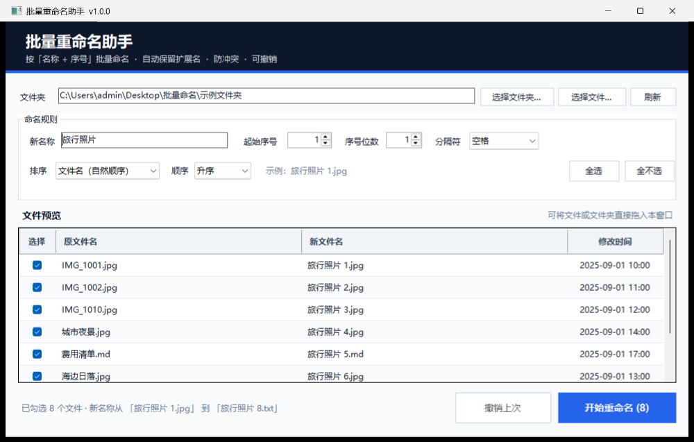

# 批量重命名助手 使用说明

一个专为 Windows 做的小工具：把一堆文件按「名称 + 序号」批量命名，例如：

- `某某 1.jpg`
- `某某 2.jpg`
- `某某 3.jpg`

扩展名会自动保留，排列顺序、起始序号、补零位数、分隔符都能调整。所有操作先在窗口里预览，确认后才会执行，并支持撤销最近一次。



## 一、文件说明

| 文件 | 用途 |
| --- | --- |
| `一键批量重命名.bat` | **双击这个文件启动工具** |
| `BatchRename.ps1` | 主程序，请勿删除或单独移动 |
| `使用说明.md` | 本说明 |
| `界面预览.png` | 界面截图（可删除，不影响使用） |

请把 `.bat` 和 `.ps1` 放在**同一个文件夹**里。不需要安装 Python、Office 或其他软件，使用 Windows 自带的 PowerShell 即可。

支持 Windows 10 / Windows 11。

## 二、快速上手

1. 双击 **`一键批量重命名.bat`**。
2. 点击「选择文件夹…」，选中要处理文件所在的文件夹；也可以直接把文件或文件夹**拖进窗口**。
3. 在「新名称」里输入基础名称，例如：`某某`。
4. 在下方预览表里核对「新文件名」。不需要处理的文件，取消它左侧的勾选。
5. 点击右下角「开始重命名 (N)」，确认后完成。

完成后按钮会变成「撤销上次」。如果对结果不满意，点击它即可恢复原来的文件名。

## 三、命名规则

### 1. 名称与序号

生成格式为：

```text
新名称 + 分隔符 + 序号 + 原扩展名
```

例如新名称填 `某某`、分隔符选「空格」、起始序号为 `1`：

| 原文件名 | 新文件名 |
| --- | --- |
| `IMG_001.jpg` | `某某 1.jpg` |
| `IMG_002.jpg` | `某某 2.jpg` |
| `会议记录.txt` | `某某 3.txt` |

### 2. 起始序号

默认从 `1` 开始，可以改成 `0` 或其他数字。

### 3. 序号位数（补零）

- 位数填 `1`：`某某 1`、`某某 2`、`某某 10`
- 位数填 `2`：`某某 01`、`某某 02`、`某某 10`
- 位数填 `3`：`某某 001`、`某某 002`、`某某 010`

序号超过位数时不会截断，例如位数填 `2` 时，第 100 个文件仍是 `某某 100`。

### 4. 分隔符

可选：

- 空格：`某某 1.jpg`
- 下划线：`某某_1.jpg`
- 短横线：`某某-1.jpg`
- 无：`某某1.jpg`

### 5. 排序

编号严格按照窗口中**从上到下**的顺序生成。排序方式可以选：

- 文件名（自然顺序，推荐）：`IMG_2` 会排在 `IMG_10` 前面
- 修改时间
- 创建时间

还可以选择升序或降序。改变排序后，预览和编号会自动更新。

### 6. 只处理勾选的文件

- 表头的「全选 / 全不选」可以快速切换。
- 只有勾选的文件才会被重命名，并且序号只分配给勾选的文件。
- 例如取消第 2 个文件后，原来的第 3 个文件会变成序号 2。

## 四、撤销

每次成功重命名后，工具都会保存一份「最近一次操作」记录。

- 点击「撤销上次 (N)」并确认，即可把刚才改过的文件恢复原文件名。
- 关闭工具后再打开，仍可撤销最近一次操作。
- 再次执行新的重命名，会覆盖旧的撤销记录。
- 如果之后移动、删除或手动改名了相关文件，撤销可能失败，工具会提示哪些文件有问题，并且不会强行覆盖。

撤销记录保存在：

```text
%LOCALAPPDATA%\BatchRenameHelper\last-operation.json
```

## 五、安全设计

- **先预览，后执行**：执行前必须确认，默认按钮是「否」。
- **不会覆盖已有文件**：如果目标名称已存在，整批操作会被阻止，不会只改一半。
- **两步改名**：需要互换名称时，也会先改成临时名称再落到目标名称，避免相互覆盖。
- **失败自动回滚**：中途出错时会尝试恢复原名。
- **自动排除工具自身**：如果处理文件夹里包含本工具的 `.bat`、`.ps1`、说明文件或预览图，会自动跳过。
- **只改文件名**：不会修改文件内容，也不会删除文件。
- **非法名称拦截**：包含 `\ / : * ? " < > |` 等 Windows 不允许的字符时，会在预览阶段提示。

## 六、注意事项

- 只处理所选文件夹**第一层**的文件，不处理子文件夹。
- 默认不显示隐藏文件和系统文件，因此它们也不会被重命名。
- 扩展名会保留。对于 `archive.tar.gz` 这类复合扩展名，只会保留最后一个 `.gz`。
- 大文件、只读文件也可以改名；能否改名仍取决于 Windows 文件权限。
- 新名称最长 180 个字符，完整路径需在 255 个字符以内。
- 编号只对**当前勾选**的文件生效。
- 一般不需要管理员权限。如果以管理员身份运行，从普通资源管理器拖放文件到窗口可能失效。

## 七、常见问题

### 双击后没有反应？

先确认 `一键批量重命名.bat` 和 `BatchRename.ps1` 在同一个文件夹里，然后尝试手动启动：

1. 在文件夹空白处按住 `Shift` 右键，选择「在终端中打开」或「在此处打开 PowerShell 窗口」。
2. 执行：

```powershell
powershell -NoProfile -STA -ExecutionPolicy Bypass -File .\BatchRename.ps1
```

### 提示「禁止运行脚本」怎么办？

用本工具自带的 `.bat` 启动即可，它已经自动带上 `-ExecutionPolicy Bypass`。也可以使用上面的手动命令。

### 拖放没有反应？

直接把文件或文件夹拖到窗口中部较大的「文件预览」区域；一次拖入一个文件夹，或者同一文件夹中的多个文件。不同文件夹的文件请分开处理。

### 为什么「开始重命名」是灰色的？

原因可能是：

- 还没有选择文件夹；
- 「新名称」为空或包含非法字符；
- 所有文件都被取消了勾选。

按窗口底部状态栏的提示处理即可。

### 为什么提示「目标文件已存在」？

说明新名称与文件夹中已有文件重名了。工具不会覆盖任何文件。可以：

- 换一个「新名称」；
- 调整起始序号；
- 先把冲突文件移走或改名；
- 取消勾选不需要处理的文件。

### 为什么无法撤销？

撤销只保留最近一次成功操作，并且要求相关文件仍在原来的位置。若文件被移动、删除或手动改名，撤销会失败。新的重命名也会覆盖旧记录。

## 八、进阶启动方式

如果希望启动后直接打开某个文件夹，可以在 PowerShell 中执行：

```powershell
powershell -NoProfile -STA -ExecutionPolicy Bypass -File .\BatchRename.ps1 -StartFolder "D:\照片"
```

## 九、错误日志与清理

启动或运行时出现意外错误，可查看日志：

```text
%LOCALAPPDATA%\BatchRenameHelper\error.log
```

彻底清理本工具：

1. 删除本工具所在的文件夹；
2. 如需同时删除撤销记录和日志，删除 `%LOCALAPPDATA%\BatchRenameHelper` 文件夹即可。

本工具完全在本机运行，不会上传任何文件或文件名。
